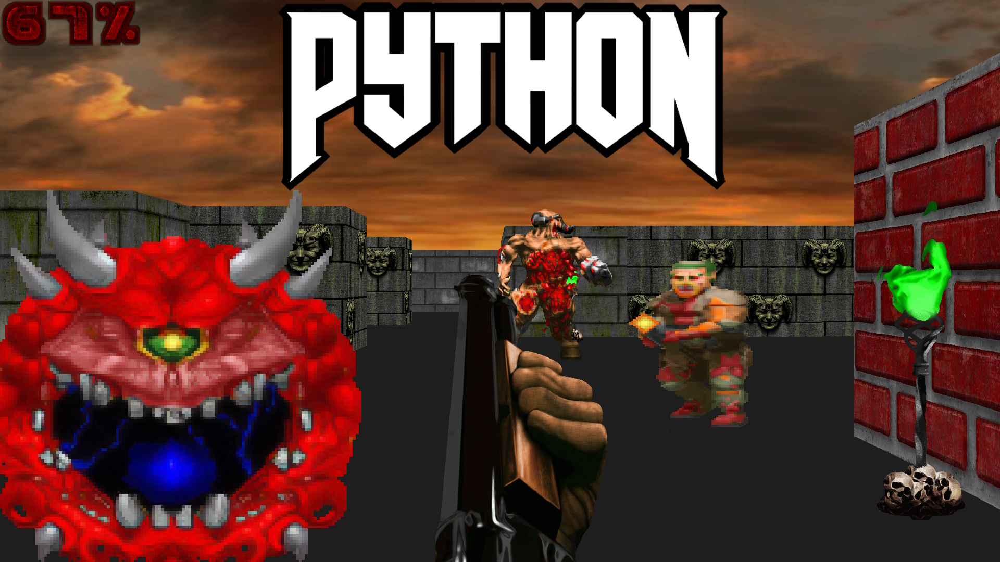

> [!IMPORTANT]
> **About this repository**
> The engine follows **[DOOM-style-Game](https://github.com/StanislavPetrovV/DOOM-style-Game)** by Stanislav Petrov, released under the MIT License: the ray-casting renderer, map, sprites, sound and the enemy pathfinding come from that project. My additions are the mini-map (`minimap.py`), pickups (`pickups.py`), the weapon manager (`weapon_manager.py`), spawn balancing and the Windows build.

---

# DOOM style 3d (raycasting) game in Python (based on Wolfenstein 3d)

Control: 'WASD' + mouse


# Combat — DOOM-Style 3D Raycasting FPS (Python + Pygame)

A DOOM/Wolfenstein-inspired first-person shooter built in **Python** using **Pygame**, featuring a real-time **raycasting engine**, **AI-controlled enemies**, shortest-path navigation (breadth-first search on the map grid), and gameplay balancing (spawn control to avoid overwhelming the player).

🎮 **Play / Download (Windows build):** https://vishalkrishna.itch.io/combat

---

# Combat — DOOM-Style AI FPS Game (Python + Pygame)

A DOOM-style first-person shooter built in **Python** using **Pygame**, featuring **real-time ray-casting**, **AI-driven enemies**, **shortest-path navigation**, and **dynamic spawn balancing**.

🎮 **Play / Download (Windows Build):**  
https://vishalkrishna.itch.io/combat

---

## Features

### 🔫 Core FPS Gameplay
- DOOM-style first-person movement with smooth mouse-controlled camera rotation  
- Real-time ray-casting renderer for immersive 3D visuals  
- Weapon system with responsive shooting mechanics  
- Health, ammo, and pickups  
- Mini-map with player and enemy tracking  

### 🤖 Enemy AI & Game Balancing
- Enemies navigate the map using **breadth-first search on the map grid**  
- AI enemies actively **hunt and engage** the player  
- Dynamic spawn balancing prevents too many enemies appearing at once  
- Real-time enemy movement and combat updates  

---

## Controls

| Action | Key |
|------|-----|
| Move Forward | **W** |
| Move Backward | **S** |
| Strafe Left | **A** |
| Strafe Right | **D** |
| Look / Aim | **Mouse** |
| Shoot | **Space** |
| Exit | **Esc** (if enabled) |

> Tip: You can play in fullscreen or windowed mode depending on your system.

---

## Requirements

- **Python 3.11+** (recommended)  
- Windows / macOS / Linux (Windows works best with Pygame)  

Dependencies are listed in `requirements.txt`.

---


### 1) Clone the repository
```bash
git clone https://github.com/Vishal-Krishna-Kumar/Combat-Algo-Game.git
cd Combat-Algo-Game
```


### 2) Create & activate virtual environment
```bash
py -3.11 -m venv venv
.\venv\Scripts\Activate.ps1
```

### 3) Install dependencies
```bash

pip install -r requirements.txt
```

### 4) Run the game
```bash
python main.py

```


🏗  Build Windows EXE (Optional)

1) Install PyInstaller
pip install pyinstaller

2) Build
pyinstaller --noconfirm --windowed --onedir main.py --add-data "resources;resources"


The game will be created at:

dist/main/main.exe


If you have folders like sounds/, textures/, or sprites/, include them with --add-data.


```bash

📁 Project Structure
Combat-Algo-Game/
│
├── main.py
├── requirements.txt
├── resources/
│   ├── sounds/
│   ├── sprites/
│   └── textures/
├── screenshots/
└── ...
```


⚙ How It Works
###Ray-Casting Engine

The game renders a 3D-like world by casting rays from the player’s viewpoint and computing wall intersections, similar to DOOM and Wolfenstein-3D. This provides high performance with a classic FPS feel.

Enemy Pathfinding

Enemies use breadth-first search on the map grid to:

Navigate around walls

Chase the player intelligently

Avoid getting stuck

Spawn Balancing

The game limits how many enemies can appear at once to maintain fair gameplay and high performance.


🛠 Troubleshooting

pygame not found

pip install -r requirements.txt


Textures or sounds missing
Ensure resources/ exists.
When building EXE, include:

--add-data "resources;resources"


PowerShell can’t activate venv

Set-ExecutionPolicy -Scope CurrentUser RemoteSigned
.\venv\Scripts\Activate.ps1


🧭 Roadmap

More enemy types & smarter AI

New maps and level editor

Improved UI (health, ammo, settings)

Browser build (WebAssembly via pygbag)```

Author

Vishal Krishna Kumar
GitHub: https://github.com/Vishal-Krishna-Kumar

Itch.io: https://vishalkrishna.itch.io/combat


